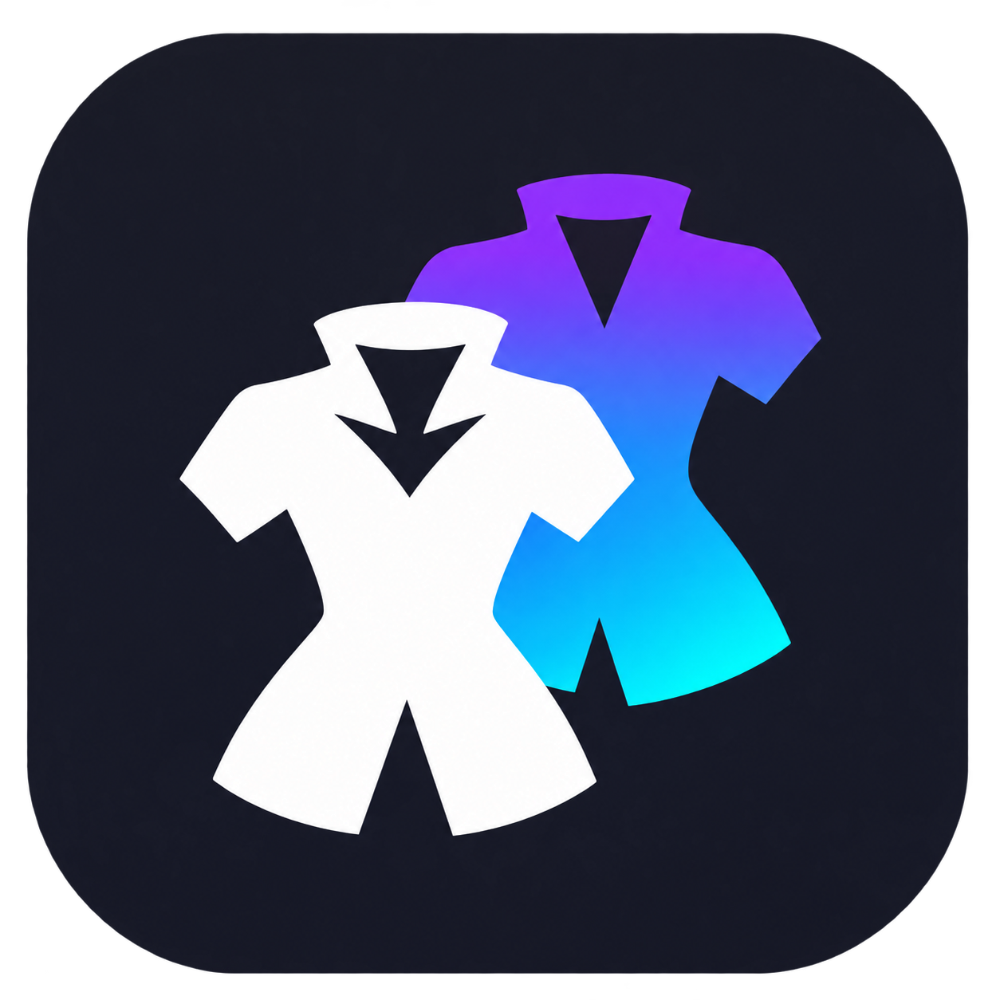
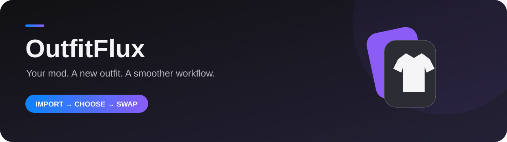
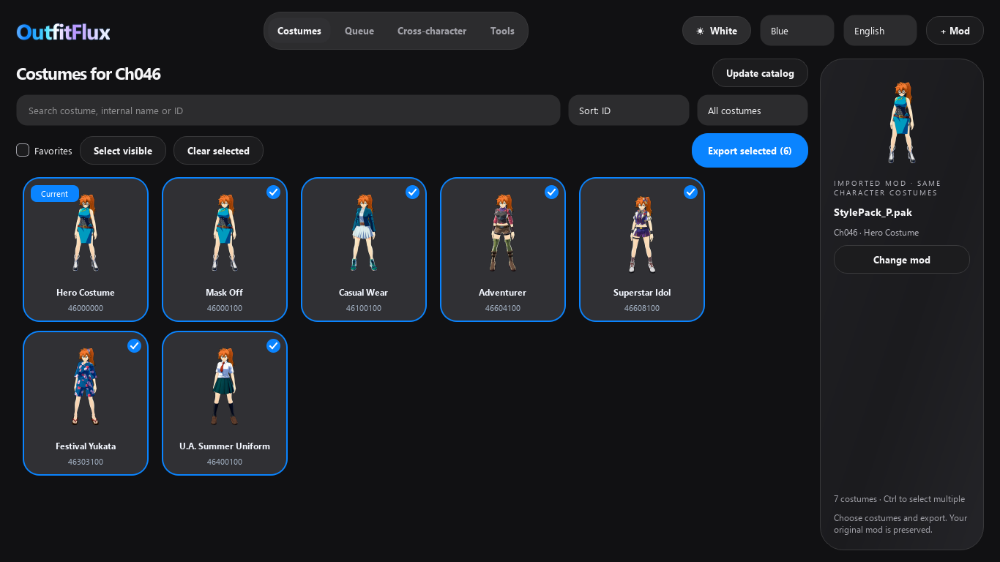
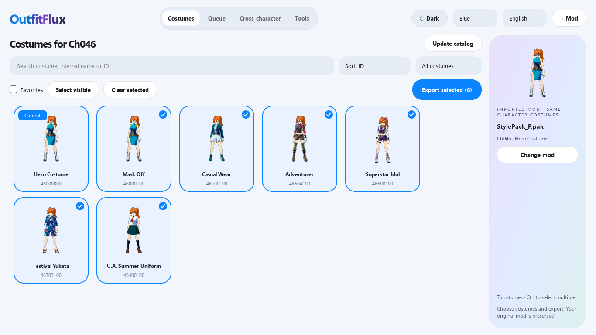
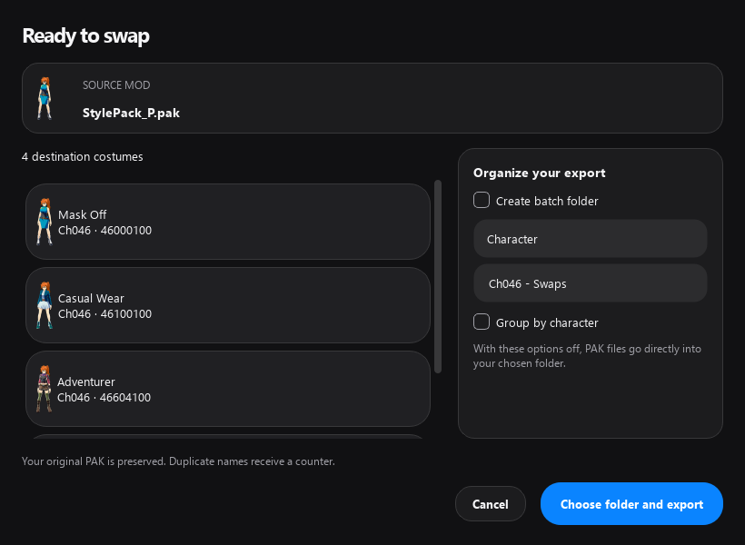
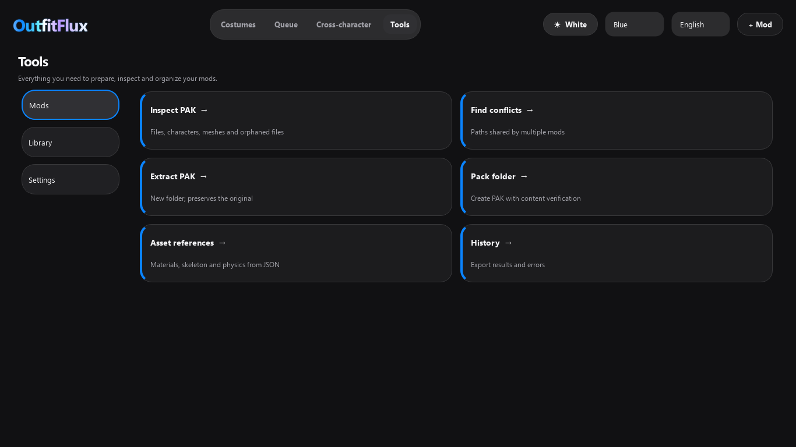
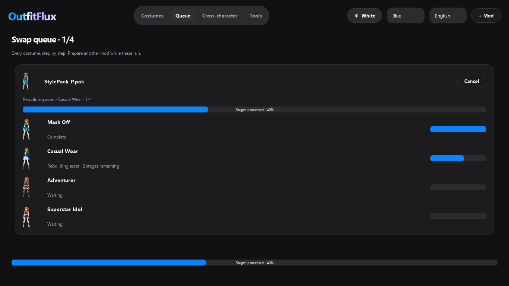

<div align="center">


# OutfitFlux
### Your mod. A new outfit. A smoother workflow.

🪟 Windows · 🎨 Dark & Light · 🌐 English & Spanish · 📦 Batch exports

[Get started](#-get-started) · [Screenshots](#-a-place-for-everything) · [Development](docs/DEVELOPMENT.md) · [Release guide](docs/PUBLISHING.md)
</div>



## ✨ Made for your next costume swap

OutfitFlux is a desktop costume-slot swapper for **My Hero Ultra Rumble**, built on the MHUR Model Swapper workflow. Import a PAK, choose its destination costumes, and send the selection to a background queue.

| Feature | What it does |
| --- | --- |
| 👕 Costume library | Shows the imported mod's character, marks the current costume and supports multiple destinations. |
| 🔀 Cross-character category | Browse destination characters, then choose their costumes. |
| 📦 One export action | Exports one or several selected costumes to your chosen folder. |
| 🗂️ Optional folders | Keep files directly in the destination, create a named batch folder, or group by character. |
| ⏳ Background queue | Prepare another mod in the same window while queued exports run. |
| 🎨 Personal appearance | Dark and light themes, accent colors and immediate language changes. |
| 🧰 Integrated tools | Inspect, compare, extract and pack PAK files; browse history and diagnostics. |
| ⚡ Incremental library | Reuses cached files and regenerates changed or damaged outputs. |
| 🔄 GitHub updates | Checks a configured public repository for compatible stable releases. |

## 🖼️ A place for everything



<details>
<summary>☀️ Light mode, export review and tools</summary>






Queue progress in this documentation is a staged UI demonstration; live exports report actual processing stages.

</details>

## 🚀 Get started

1. Download a Windows package from this repository's **Releases** section when one is available.
2. Extract the entire package into a writable folder. Keep `OutfitFlux.exe` beside `_internal`.
3. Open the app and configure the game PAK, language and appearance.
4. Use **Tools → Library → Prepare library** for the first import of game data.
5. Import your mod PAK. Select destination costumes and click **Export selected**.
6. Review the selection, choose your output folder and follow progress in **Queue**.

**Folder behavior:** with both folder options off, every exported PAK goes directly into the folder you choose. The source PAK stays untouched. Existing output names receive a counter.

The first-run setup appears once per Windows user. You can reopen Settings from Tools at any time. The library is generated locally; game assets and mods are not included in this source repository.

## 🛠️ Build and customize

See [Development](docs/DEVELOPMENT.md) for the Python environment, required external tools, tests and packaging. See [Brand kit](docs/BRAND.md) for editable artwork and screenshot generation.

```powershell
py -3.10 -m venv .venv
.\.venv\Scripts\Activate.ps1
python -m pip install -r requirements-dev.txt
python main.py
```

The interface can launch before tool setup; extraction and export require the dependencies listed in the development guide.

## 🧪 Compatibility

The exporter verifies PAK contents, but that does not validate every visual combination in game. Cross-character results depend on the assets involved. The app does not claim a universal skeleton-retargeting system.

## 🤝 Credits

Based on [XShawolf / MHUR-Model-Swapper](https://github.com/XShawolf/MHUR-Model-Swapper), with tools including [UAssetAPI](https://github.com/atenfyr/UAssetAPI), [repak](https://github.com/trumank/repak), [UE4-DDS Tools](https://github.com/matyalatte/UE4-DDS-Tools), UnrealPak and FFmpeg. See [Third-party notes](docs/THIRD_PARTY.md).

This project is not affiliated with the game's developers or publishers. No new license grant is assigned to inherited code by this repository preparation; see the third-party notes before selecting the project's license.
